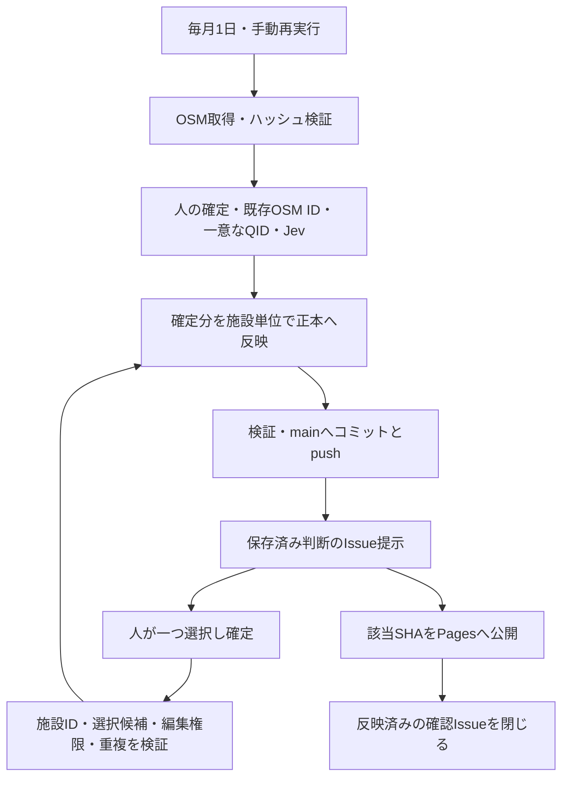

# データフロー

既存OSM IDが取得結果に残る間は接続を維持します。失われた接続と未接続の対象を、一意なQID、Jevの順に照合します。候補なしや確定した「該当なし」では参照だけを解除し、UUIDと座標を残します。

`inputs/facilities.json`が検索対象、`data/places.jsonld`が施設の正本、`data/osm-decisions.json`が施設ごとの判断記録です。取得物と取得元・ハッシュは`imports/openstreetmap/`へ保存します。判断待ちでも、ほかの施設の確定分は公開します。

取得・検証・外部APIの障害はActionsの失敗として扱い、その実行のデータ変更を公開しません。判断の不確かさは施設ごとの確認Issueで扱い、接続先がない対象は一つの通常Issueへまとめます。[Issueの操作手順](../how-to/review-osm-candidates.md)に従って回答してください。

更新から公開まで同時実行を制限します。待機実行が置き換わっても回答を失わないよう、毎回、記録にある未解決Issueを読み直します。mainへのpushが失敗した場合は停止し、取得やJev判定から自動でやり直しません。判断をGitへ保存する前にIssueへ提示しません。提示だけなら保存済み判断から再実行できます。

`GITHUB_TOKEN`によるpushから通常のpush起点workflowは起動しないため、更新workflowは公開workflowを明示的に呼び、反映コミットSHAを渡します。[GitHubの制約](https://docs.github.com/en/actions/how-tos/writing-workflows/choosing-when-your-workflow-runs/triggering-a-workflow)

Pagesの公開元はSettings → Pages → Build and deploymentで`GitHub Actions`に設定します。公開直前にmainのSHAを検査し、古いSHAなら公開を失敗させます。公開に失敗した確認Issueは開いたまま残り、再実行で公開後の完了処理を行います。

公開物はJSON-LDです。判断記録、取得物、確認本文は配布しません。公開対象の指定とReleaseも含む契約は[データ契約](../reference/data-contracts.md)を参照してください。公開データを戻す場合は[リリース手順の復元操作](../how-to/publish-release-jsonld.md#5-公開済み版へ戻す)を使い、mainをforce-pushしません。
